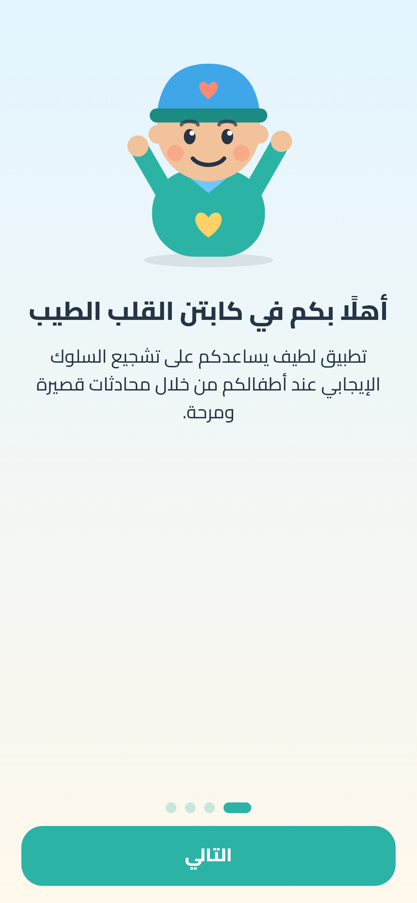
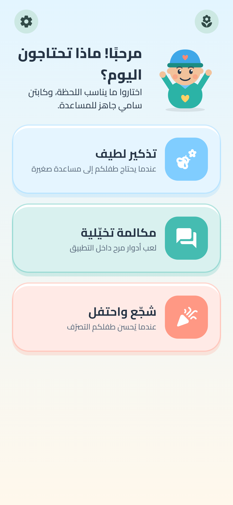
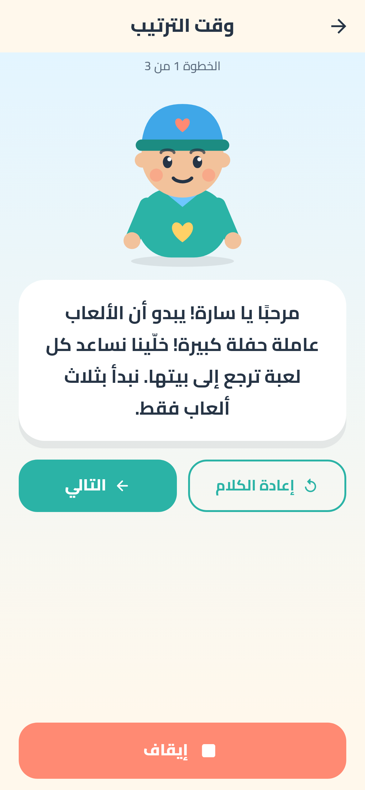
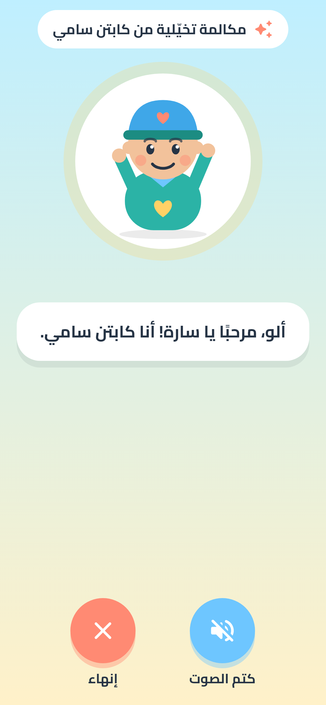
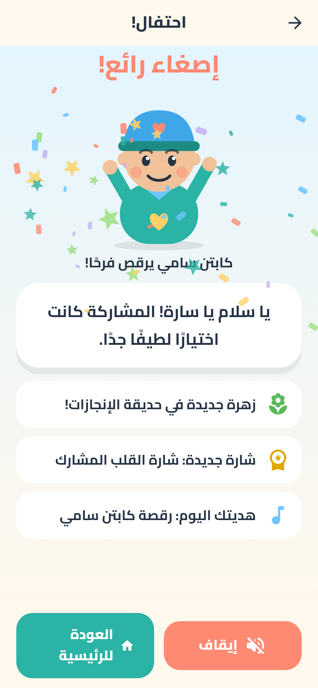
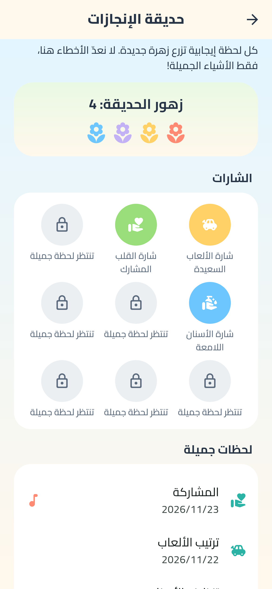

# Captain Kindheart · كابتن القلب الطيب

A playful, Arabic-only Flutter app that helps parents encourage positive behaviour in young children through short conversations with **Captain Sami**, a friendly, clearly fictional cartoon helper. It is a safe alternative to frightening children with "the police will come": no real calls, no threats, just gentle reminders, pretend role-play, and lots of celebration.

| Onboarding | Home | Reminder | Pretend call | Celebration | Garden |
| --- | --- | --- | --- | --- | --- |
|  |  |  |  |  |  |

## Features

- **Gentle reminder:** six situations (tidy up, gentle hands, indoor voice, sharing, listening, bedtime). One instruction, a two-option choice, then reassurance. Parents can rewrite the wording.
- **Pretend character call:** a cartoon, in-app "call" from Captain Sami with Answer, Mute, and an always-visible End. A parent explanation appears before first use. No telephony code at all.
- **Praise and celebrate:** nine positive behaviours, optional rewards, confetti, a Sami dance, collectible badges, and an achievement garden with no scores or streaks.
- **Personalisation:** optional child nickname (local only) used in Arabic dialogue, with gender-neutral fallbacks chosen by the parent.
- **Parent controls:** parent gate, voice on/off, voice style, volume, quiet mode, session length, privacy info, and reset.
- **Arabic only, RTL throughout,** Cairo font, scalable text, phone and tablet layouts.

Docs: [Product requirements and user flow](docs/PRD.md) · [Architecture](docs/ARCHITECTURE.md) · [Asset checklist](docs/ASSET_CHECKLIST.md) · [Demo script](docs/DEMO_SCRIPT.md)

## Setup

Requires Flutter **3.50+** (Dart 3.14+), plus Android Studio / Xcode for device builds.

```bash
flutter pub get
flutter run                 # on a connected device or emulator
```

For voice, the device needs an Arabic text-to-speech voice:
- **Android:** Settings → System → Languages → Text-to-speech → Google TTS → install Arabic.
- **iOS:** Settings → Accessibility → Spoken Content → Voices → Arabic.

Without one, the app still works and shows Captain Sami's words as text.

## Build

```bash
flutter build apk --release         # Android APK
flutter build appbundle --release   # Play Store bundle
flutter build ipa --release         # iOS (needs signing in Xcode)
```

## Test

```bash
flutter analyze
flutter test                                     # 49 unit + widget tests
flutter test screenshots_test --update-goldens   # regenerates docs/screenshots
```

Safety-critical coverage includes: stop/end silencing audio immediately, no further lines after a call ends, quiet mode and mute, the parent gate, the first-call parent explanation, a word-list check on every child-facing line, and a check that the code and manifest contain no telephony, SMS, URL-launching, or emergency-number usage.

## Packages

| Package | Why |
| --- | --- |
| `get` | State management, routing, DI, translations |
| `shared_preferences` | Local-only storage of settings, name, wording, progress |
| `flutter_tts` | On-device Arabic speech behind `AudioService` |
| `flutter_localizations` | Arabic Material/Cupertino localisations and RTL |
| `fake_async` (dev) | Deterministic timer tests |

## Project structure

See [docs/ARCHITECTURE.md](docs/ARCHITECTURE.md). In short: `lib/app` (app shell, routes, theme), `lib/core` (translations, utils), `lib/data` (models, mock content, repositories), `lib/services` (storage, audio), `lib/features/*` (one folder per screen group, each with its GetX controller), `lib/widgets` (shared UI including the animated Captain Sami).

All user-facing strings are in `lib/core/translations/` (`TranslationsKeys` + `ar_translations.dart`), referenced as `TranslationsKeys.someKey.tr`.

## Known limitations

- **Artwork is placeholder.** Captain Sami, situation art, badges, and the app icon are drawn in code or use Material icons. See the asset checklist.
- **Voice is device TTS.** Quality depends on the installed Arabic voice, and TTS may choose masculine vowelling for a few verbs. Professionally recorded lines are the recommended upgrade.
- **Parent wording is typed, not recorded.** Audio recording of the parent's voice is not in release 1.
- **No sound effects yet.** Only speech plays; gentle chimes can be added through `AudioService`.
- **Material import:** Flutter 3.47+ deprecates `package:flutter/material.dart` in favour of `material_ui`, but GetX 4.7 still uses the old import. The app follows GetX for type compatibility; the deprecation lint is silenced. Migrate when GetX updates.
- **Not yet built on physical devices in CI.** Tests and analysis pass; Android/iOS release builds need a machine with the Android SDK / Xcode.
