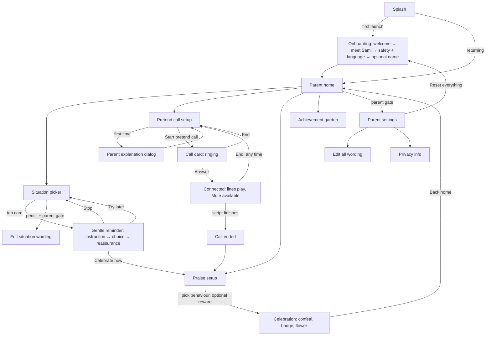

# Captain Kindheart — Product Requirements (Release 1)

**Arabic name:** كابتن القلب الطيب · **Character:** كابتن سامي (Captain Sami)
**Platforms:** Android and iOS (Flutter) · **Language:** Arabic only, RTL

## 1. Problem and goal

Some parents threaten young children with "the police will come" to get them to listen. That works through fear and can damage a child's trust in real helpers. Captain Kindheart gives parents a better tool: a warm, clearly fictional helper who encourages positive behaviour through short, playful conversations and celebrates effort.

**Success looks like:** a parent can calm a tricky moment in under 30 seconds, celebrate good choices often, and never feel tempted to use fear.

## 2. Users

| User | Needs |
| --- | --- |
| Parent / caregiver (primary operator) | Fast access in the moment, control over what plays and when, familiar family wording, privacy. |
| Child, roughly 3–8 (audience) | Friendly character, very short sentences, big buttons, visible celebration, nothing scary. |

The parent operates the app. The child watches, listens, and taps choice buttons or "end".

## 3. Non-negotiable safety rules

1. Captain Sami is an original cartoon helper. No police badge, logo, uniform, siren, or red/blue lights. Not presented as a real officer.
2. The pretend call is an in-app animation. The app has **no** telephony, SMS, dialer, URL launcher, or emergency-number code, and requests no phone permissions. A test enforces this.
3. No threats, countdowns, jump scares, loud audio, shame, or negative labels. Child-facing lines are checked by an automated word-list test.
4. Every interaction has a large, always-visible stop/end control that silences audio immediately.
5. A parent-facing explanation appears before the first pretend call: "This is make-believe role-play, not a real police call."
6. Parents are encouraged to stay with the child and explain the character is pretend.

## 4. Features

### A. Gentle Reminder (تذكير لطيف)
- Six illustrated situation cards: tidy up, gentle hands, indoor voice, sharing, listening, bedtime.
- Each runs three steps: warm instruction → a two-option choice → reassurance.
- Replay, next, and a big stop button. Voice optional; text always visible.
- Parents can edit a situation's title and main message (behind the parent gate). `{الاسم}` in custom text becomes the child's name.
- At the end the parent chooses "celebrate now" (goes to praise, behaviour preselected) or "try later".

### B. Pretend Character Call (مكالمة تخيّلية)
- First use shows the parent explanation dialog (re-openable from the setup screen).
- Parent picks one of four supportive scripts and taps "Start pretend call".
- Cartoon call card labelled "مكالمة تخيّلية من كابتن سامي". No caller ID, number, or phone-OS look.
- Ringing state: Answer and End. Connected: Mute and End. End is always visible and stops audio, timers, and animation at once.
- After the call: back, or go straight to praise.

### C. Praise & Celebrate (شجّع واحتفل)
- Pick one of nine behaviours (tidying, sharing, gentle hands, teeth, please/thank you, routine, listening, helping, trying again).
- Optional reward: sticker, Captain Sami dance, bedtime story, choose the next activity.
- Celebration: random cheer, personalised effort-focused message, confetti and stars, Sami dances if "dance" is chosen, a new flower, and a badge the first time that behaviour is celebrated.

### D. Achievement Garden (حديقة الإنجازات)
- Flowers for every positive moment, collected badges, and recent moments.
- No scores, no negative records, no streaks that can be broken.

### E. Parent settings (behind the parent gate)
- Child profile: optional nickname (edit/clear anytime), fallback form of address, age range, avatar, language (Arabic, fixed).
- Voice: on/off, style (calm, warm, cheerful), volume, test.
- Usage: quiet mode (no voice, reduced motion), session length (3/5/10 minutes; Sami says goodbye gently when time is up).
- Content: edit situation wording. Privacy information. Reset garden / reset everything.

## 5. Personalisation and gender-neutral Arabic

- Name is optional; skip is one tap. Stored only on the device.
- Lines use a vocative token: "مرحبًا يا سارة!" or, without a name, the parent's chosen phrase ("يا نجم البيت" by default; also "يا بطل", "يا بطلة", "يا شطّور", "يا شطّورة", "يا حبيب القلب").
- Dialogue favours "let's" forms (خلّينا، يلا، نقدر) and neutral praise (برافو، عمل رائع) to avoid assuming gender. Spoken TTS may still pick masculine vowelling for a few verbs; see known limitations.

## 6. Parent gate

A multiplication question (factors 3–9), answered with Western or Arabic-Indic digits, guards settings and script editing. Release 1 has no purchases or external links; any added later must sit behind the same gate.

## 7. Privacy

- Local-first: settings, name, overrides, and progress in on-device storage (`shared_preferences`).
- No accounts, no network calls, no analytics SDK, no ads.
- Speech uses the device's built-in text-to-speech engine.

## 8. User flow

## 9. Acceptance criteria → where they are met

| Criterion | Implementation | Test |
| --- | --- | --- |
| Select a situation and play a reminder | `features/reminder` | `gentle reminder plays a personalised message…` |
| Start a clearly labelled in-app pretend call | `features/pretend_call` | `pretend call: end is always visible…`, `first pretend call shows the parent explanation` |
| Never triggers dialer/call/SMS/emergency | No telephony code or permissions | `content_safety_test.dart` |
| End any interaction immediately, audio stops | `AudioService.stop`, `StopButton`, `PretendCallController.end` | `audio_service_test`, `controllers_test`, widget tests |
| Praise messages and non-competitive rewards | `features/praise`, `features/progress` | `praise flow awards a badge…`, `CelebrationController` tests |
| Arabic with RTL | `TranslationsKeys` + `ar_translations.dart`, forced RTL | translation completeness test, RTL assertion in onboarding test |
| Adapts to screen sizes | `LayoutBuilder` grids, max-width shell, clamped text scale | `home adapts to a tablet width…` |
| Supportive, non-threatening content | Content library | forbidden-word test |

## 10. Assumptions and product decisions

- **Parent-recorded wording** is implemented as parent-*written* wording spoken by TTS. Audio recording is a planned follow-up (needs a microphone permission and recording package).
- **Gentle sound effects** are not bundled yet; the only audio is speech. Silent switch is respected on iOS (ambient audio category).
- **Captain Sami artwork** is drawn in code as a placeholder so the demo is self-contained; see the asset checklist.
- **Age range** is stored for future content tuning; release 1 content is written for ages 3–8.
- **Name and gender:** no gender field is collected. Parents choose the form of address if they skip the name.
